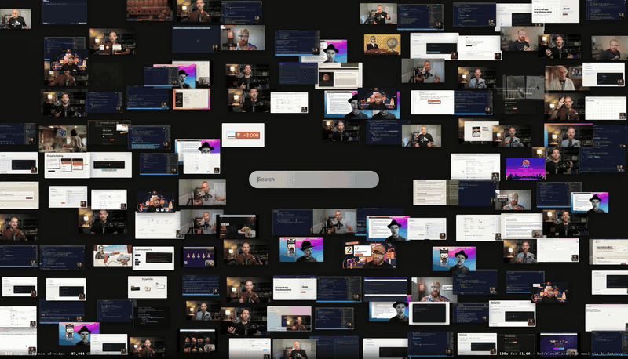

# Clef-omni media search

Type into a search box and video clips fly in, matched on what is **seen**, **heard**, and **said**
in each clip. It's a video and audio take on
["Fast image search with Jev"](https://x.com/shridharathi/status/2101715395925184678), built on
[Clef-omni](https://developers.cloudflare.com/workers-ai/models/clef-omni/), Cloudflare's multimodal
decision model on Workers AI.

[](docs/demo.mp4)

[Full demo video (52 s)](docs/demo.mp4)

- **70 min** of video (9 Cloudflare Developers YouTube videos), cut into **523** clips of 8 s each
- **87,864** Clef-omni decisions (168 yes/no questions per clip), indexed in **100 s** for **$1.69**
- Every search runs in the browser in about **0.2 ms**, with **zero API calls per keystroke**
- **Enter** runs a live Clef-omni search for anything the index doesn't cover, e.g. "man wearing an orange cap"

## How it works

Clef-omni is not an embedding model or a chat model. It takes a *state* (text, images, audio, video)
plus typed questions, and returns a calibrated probability for every answer. One call watches the
frames **and** listens to the soundtrack, so there is no transcription or captioning step.

```
download.py   yt-dlp the source videos                         media/raw/*.mp4
ingest.py     cut into 8 s, 480p, 15 fps clips + poster frames   web/media/{segments,posters}/
classify.py   ask Clef-omni the 168 questions in concepts.py     web/data/index.json
              about every clip (3 requests of 64 questions max)
serve.py      static UI + /api/deep live search                  http://127.0.0.1:8790
```

- **Concepts** (`concepts.py`) are plain-English yes/no questions, each tagged with the sense that answers it:
  - `see`: "Is a person wearing a hat visible in the video?"
  - `hear`: "Does the speaker sound excited or enthusiastic?"
  - `say`: "Does someone in the audio talk about Durable Objects?"
  - `both`: "Is someone explaining code that is visible on screen?"
- **Search** (`web/search.js`) maps your query to 1-3 concepts and ranks clips by P(yes). Concepts are
  matched on their labels and synonyms, plus a small sentence-embedding model that runs in the browser
  (`web/embed-worker.js`), so "spectacles" finds glasses. Queries can combine and negate concepts
  ("code but no person", "hat and phone"). Phrasing picks the sense: "python mentioned" asks what was
  said, "python on screen" asks what was seen.
- **Live search** (`serve.py`, press Enter) asks Clef-omni the literal query about the top candidates
  (or the whole wall) in parallel. Results stream back as NDJSON, and stragglers after 6 s are dropped.
  Answers are cached in `media/deep.jsonl`.
- **Click** any tile to play the source video from that moment. A list shows what Clef-omni saw,
  heard, and understood in that clip.

## Run it

Requirements: Python 3.10+, [ffmpeg](https://ffmpeg.org), and [yt-dlp](https://github.com/yt-dlp/yt-dlp).

```sh
git clone https://github.com/lucataco/clef-omni-media-search
cd clef-omni-media-search
pip install -r requirements.txt

python download.py   # the 9 demo videos, ~450 MB
python ingest.py     # ~2-3 min; cuts 523 clips and checks them against the precomputed index
python serve.py      # http://127.0.0.1:8790
```

The repo ships the precomputed `web/data/index.json`, so typed search works without a Cloudflare account.
Open `http://127.0.0.1:8790/?demo=1` to play the scripted demo from the video. A custom script works too,
e.g. `?demo=hat|excited|!man wearing an orange cap`, where a leading `!` presses Enter for a live search.

### Live search and re-indexing (needs Cloudflare)

Copy `.env.example` to `.env` and set:

```sh
CLOUDFLARE_ACCOUNT_ID=...
CLOUDFLARE_API_TOKEN=...      # account token with "Workers AI Read" (+ "AI Gateway Run" if using a gateway)
CLOUDFLARE_AI_GATEWAY=        # optional gateway id, e.g. "default", to route and bill through AI Gateway
```

You can create the token in the dashboard, or with the [`cf` CLI](https://developers.cloudflare.com/cf/):

```sh
cf accounts tokens create --body '{
  "name": "clef-omni-media-search",
  "policies": [{
    "effect": "allow",
    "resources": {"com.cloudflare.api.account.<ACCOUNT_ID>": "*"},
    "permission_groups": [{"id": "a92d2450e05d4e7bb7d0a64968f83d11"}, {"id": "644535f4ed854494a59cb289d634b257"}]
  }]
}'
```

The two permission groups are Workers AI Read and AI Gateway Run. To pay with prepaid AI Gateway credits,
set the gateway's Workers AI billing to **Unified billing**, either in the dashboard (AI > AI Gateway >
Settings) or with `cf ai-gateway gateways update`. The CLI command replaces all of the gateway's
settings, so start from the output of `cf ai-gateway gateways list` and change only
`workers_ai_billing_mode` to `"unified"`.

Then:

```sh
python classify.py --ids=-F-fklPPiec_004,7CCoBvbluHA_043   # spot-check a few clips first
python classify.py                                           # index everything (~1,570 requests, ~$1.70)
```

`classify.py` is resumable. Finished requests are cached in `media/answers.jsonl`, so you can stop it
and start it again, and editing `concepts.py` only re-asks the chunk of questions that changed.

### Your own videos

```sh
rm -rf media web/media
python download.py <youtube-url-or-id> ...  # or drop your own .mp4 files into media/raw/
python ingest.py
python classify.py
python serve.py
```

Edit `concepts.py` to match your footage. Concepts that never fire are wasted questions, so spot-check
first with `--limit` or `--ids`.

## Notes

- **Cost**: Clef-omni is billed per input token ($0.15 per M). An 8 s 480p clip with sound is about
  2,200 tokens, and 64 questions add about 5,000 more, so one request costs about $0.001. Questions cost
  more than the video does.
- **Throughput**: 24 parallel workers indexed at about 20 requests/s with no rate limiting. Live-search
  latency varied from 1.5 to 5.6 s for 26 clips, depending on stragglers.
- **API quirks**: Cloudflare's bot protection rejects Python's default `urllib` user agent (error 1010).
  To route Workers AI REST calls through AI Gateway, use the normal `api.cloudflare.com/.../ai/run/...`
  endpoint with a `cf-aig-gateway-id` header.
- **Limits**: Clef-omni samples video at 2 fps, so it can't see HDR or other pixel-format properties.
  It hears speech well, but this footage has almost no non-speech sound (music, typing, applause), so
  those concepts rarely fire. Each tile shows the middle frame of its clip, so a match can happen
  elsewhere within those 8 s. The playing tiles make that visible.
- `serve.py` binds to `127.0.0.1`. Live search spends API credits, so it only accepts same-origin
  JSON requests.

The source videos belong to Cloudflare and are not included in this repo. `download.py` fetches them
from YouTube.

## License

[MIT](LICENSE)
